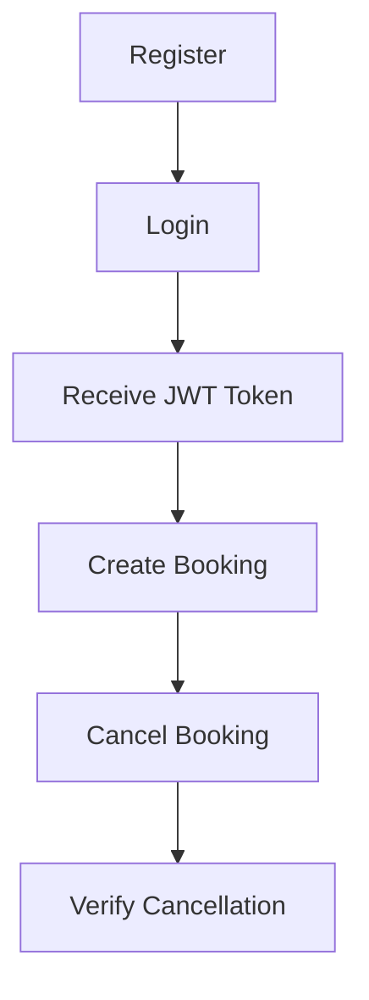

<div align="center">

# 💈 Jest Assignment — Backend API Automation

**A Jest + Supertest API automation suite for the authentication and booking functionality of a salon backend application.**


</div>

The suite focuses on **positive and negative scenarios**, **authentication**, **authorization**, **HTTP status codes**, **response validation**, **business rules**, and the **complete end-to-end booking workflow**.

---

## 📑 Table of Contents

- [Tech Stack](#-tech-stack)
- [Prerequisites](#-prerequisites)
- [Project Structure](#-project-structure)
- [Installation](#-installation)
- [Environment Setup](#-environment-setup)
- [Running the Application](#-running-the-application)
- [Jest API Automation](#-jest-api-automation)
- [APIs Covered](#-apis-covered)
- [Test Coverage](#-test-coverage)
- [Authentication & Authorization Testing](#-authentication--authorization-testing)
- [Positive & Negative Scenarios](#-positive--negative-scenarios)
- [End-to-End Workflow](#-end-to-end-workflow)
- [Test Data Strategy](#-test-data-strategy)
- [Setup & Teardown](#-setup--teardown)
- [Assertions](#-assertions)
- [Maintainability](#-maintainability)
- [Test Result](#-test-result)
- [Assignment Deliverables](#-assignment-deliverables)
- [Author](#-author)

---

## 🛠 Tech Stack

| Layer | Technology |
| --- | --- |
| Runtime | Node.js |
| Language | TypeScript |
| Framework | Express.js |
| Testing | Jest, Supertest |
| Transpiler | Babel |
| Database | MongoDB |
| Auth | JWT |

---

## ✅ Prerequisites

Make sure the following are installed before running the project:

- Node.js
- npm
- MongoDB
- Git

> [!IMPORTANT]
> MongoDB must be running locally, because both the application and the automated tests use it for data storage.

---

## 📁 Project Structure

```text
Jest-assignment/
│
├── app.ts
├── index.ts
├── package.json
├── package-lock.json
├── tsconfig.json
├── babel.config.js
├── jest.config.js
├── .gitignore
│
├── controllers/
│   ├── authController.ts
│   ├── bookingController.ts
│   └── salonController.ts
│
├── middleware/
│   └── authMiddleware.ts
│
├── models/
│   ├── Booking.ts
│   ├── Salon.ts
│   ├── Service.ts
│   ├── Stylist.ts
│   └── User.ts
│
├── routes/
│   ├── authRoutes.ts
│   ├── bookingRoutes.ts
│   └── salonRoutes.ts
│
└── tests/
    └── api.test.ts
```

---

## 📦 Installation

Clone the repository and install all dependencies:

```bash
git clone https://github.com/harsh2005-singh/Jest-assignment.git
cd Jest-assignment
npm install
```

---

## 🔐 Environment Setup

The application uses environment variables for MongoDB, JWT authentication, and the application port.

### Application environment

Create a `.env` file in the project root:

```env
MONGO_URI=mongodb://localhost:27017/salon-db
JWT_SECRET=your-secret-key
PORT=3000
```

### Test environment

The automated tests use a **separate test database**. Create a `.env.test` file in the project root:

```env
MONGO_URI=mongodb://localhost:27017/salon-db-test
JWT_SECRET=my-test-secret-123
```

> [!NOTE]
> The `.env` and `.env.test` files are ignored by Git and should not be committed to the repository.

### Setup assumptions

- MongoDB is running locally.
- The test database is separate from the normal application database.
- Test data is created during test execution.
- Unique test data is used where required to avoid conflicts.
- Test records are removed after the test suite finishes.
- The Jest tests use the Express app directly, so **the backend server does not need to be started separately** before running `npm test`.

---

## 🚀 Running the Application

| Purpose | Command |
| --- | --- |
| Start in development mode | `npm run dev` |
| Build the TypeScript application | `npm run build` |
| Start the compiled application | `npm start` |

The application runs on **http://localhost:3000**.

---

## 🧪 Jest API Automation

### Running the tests

```bash
npm test
```

Jest runs **in-band** because the tests share a database connection and test data.

| Item | Location |
| --- | --- |
| Jest configuration | `jest.config.js` |
| Babel configuration | `babel.config.js` |
| Test file | `tests/api.test.ts` |

### Test configuration

- Node.js test environment
- Test files inside the `tests` directory
- 30-second test timeout
- Mock clearing between tests
- Verbose test output
- In-band test execution
- TypeScript test files transformed using Babel

---

## 🌐 APIs Covered

| API | Method | Purpose |
| --- | :---: | --- |
| `/api/register` | `POST` | Register a new user |
| `/api/login` | `POST` | Authenticate a user and receive a JWT |
| `/api/salons/:salonId/available-slots` | `GET` | Retrieve available booking slots |
| `/api/bookings` | `POST` | Create a booking |
| `/api/bookings/:bookingId/cancel` | `POST` | Cancel a booking |

---

## 📋 Test Coverage

<details open>
<summary><b>1. Authentication API</b></summary>

**Registration**
- Successful user registration
- Duplicate email registration
- HTTP status validation
- Response message validation

**Login**
- Successful login
- Invalid login credentials
- JWT token generation
- User ID validation
- User role validation
- HTTP status validation

</details>

<details open>
<summary><b>2. Available Slots API</b></summary>

- Successfully retrieving available slots
- Missing date
- Missing service ID
- Invalid salon
- Invalid service
- Response data validation
- HTTP status validation

</details>

<details open>
<summary><b>3. Booking API</b></summary>

- Successful booking creation
- Missing date
- Invalid or missing service
- Overlapping booking
- Missing authentication
- Booking response validation
- HTTP status validation
- Booking data validation

</details>

<details open>
<summary><b>4. Booking Cancellation API</b></summary>

- Successful cancellation
- Cancellation of a non-existent booking
- Unauthorized cancellation by another user
- Cancellation of an already cancelled booking
- Missing authentication
- Response validation
- HTTP status validation

</details>

---

## 🛡 Authentication & Authorization Testing

Protected booking endpoints use **JWT authentication**. The suite validates:

- Request without an authentication token
- Request with an invalid token
- Request with a valid token
- Access by the booking owner
- Unauthorized access by another user
- Authorization behavior for booking cancellation

This ensures authentication and authorization are tested **separately**, rather than only testing successful authenticated requests.

---

## ⚖️ Positive & Negative Scenarios

| ✅ Positive scenarios | ❌ Negative scenarios |
| --- | --- |
| Registering a new user | Registering with an already existing email |
| Logging in with valid credentials | Logging in with invalid credentials |
| Retrieving available slots | Accessing protected APIs without authentication |
| Creating a booking | Using an invalid authentication token |
| Cancelling a booking | Missing required request fields |
| Completing the full booking workflow | Using an invalid salon or service |
| | Creating an overlapping booking |
| | Cancelling a non-existent booking |
| | Cancelling a booking belonging to another user |
| | Cancelling an already cancelled booking |

---

## 🔄 End-to-End Workflow

The suite includes the complete booking flow required by the assignment:



The E2E scenario verifies that the different APIs work together as a complete user flow instead of being tested only in isolation.

---

## 🗃 Test Data Strategy

The suite creates its **own test data** instead of depending on existing data:

- A unique test customer
- A second test customer for authorization testing
- A test salon
- A test service
- A test stylist

Unique values are generated where necessary so repeated runs do not fail because of duplicate data. All test data is removed during teardown.

---

## ♻️ Setup & Teardown

Jest lifecycle hooks prepare and clean up the test environment.

**Before tests**
1. Connect to the test MongoDB database.
2. Create the required test entities.
3. Create test users.
4. Perform login where required.
5. Generate authentication tokens used by protected endpoints.

**After tests**
1. Remove test records.
2. Clean up the test database data.
3. Close the MongoDB connection.

This keeps the test environment isolated and prevents data from accumulating between runs.

---

## 🔍 Assertions

The tests validate both the API response and the expected business behavior:

| Category | Examples |
| --- | --- |
| **HTTP & structure** | Status codes, response body structure, response messages, required fields |
| **Identity & auth** | Authentication tokens, user IDs, user roles, authentication behavior, authorization behavior |
| **Booking data** | Booking IDs, booking status, available slot data |
| **Business rules** | Booking conflict rules, booking cancellation rules |

---

## 🧹 Maintainability

Key design considerations:

- Dedicated Jest configuration
- Separate test database
- Reusable test data
- Reusable authentication tokens
- Logical test grouping
- Positive and negative scenarios separated clearly
- Shared setup and teardown
- E2E workflow validation
- Express application separated from server startup

The application uses `app.ts` for the Express app and `index.ts` for database connection and server startup. This lets Jest import the Express app directly without starting a separate HTTP server.

---

## 📊 Test Result

```text
Test Suites: 1 passed, 1 total
Tests:       21 passed, 21 total
Snapshots:   0 total
```

The 21 tests cover:

- Authentication
- Available slots
- Booking creation
- Booking cancellation
- Authentication failures
- Authorization failures
- Negative scenarios
- Business-rule validation
- Complete end-to-end booking workflow

---

## 📬 Assignment Deliverables

### GitHub Repository

This repository contains:

- Jest automation suite
- API test cases
- Test data setup
- Test setup and teardown
- Jest configuration
- Babel configuration
- Supporting project configuration
- README documentation

### 🎥 Loom 1 — Code Walkthrough https://www.loom.com/share/0df96d2e2f1846c5b4060703ac024c09

1. Test folder and file structure
2. API automation approach
3. Test data strategy
4. Authentication and authorization handling
5. Positive and negative test scenarios
6. End-to-end workflow
7. Important assertions
8. Design decisions and trade-offs

### 🎥 Loom 2 — Test Execution

1. Application/test environment setup
2. Running the Jest test suite
3. Test execution output
4. End-to-end workflow execution
5. Important passing scenarios

---

## 👤 Author

**Harshit Singh**
B.Tech Information Technology
